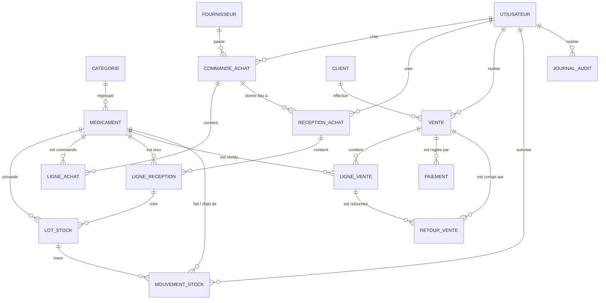
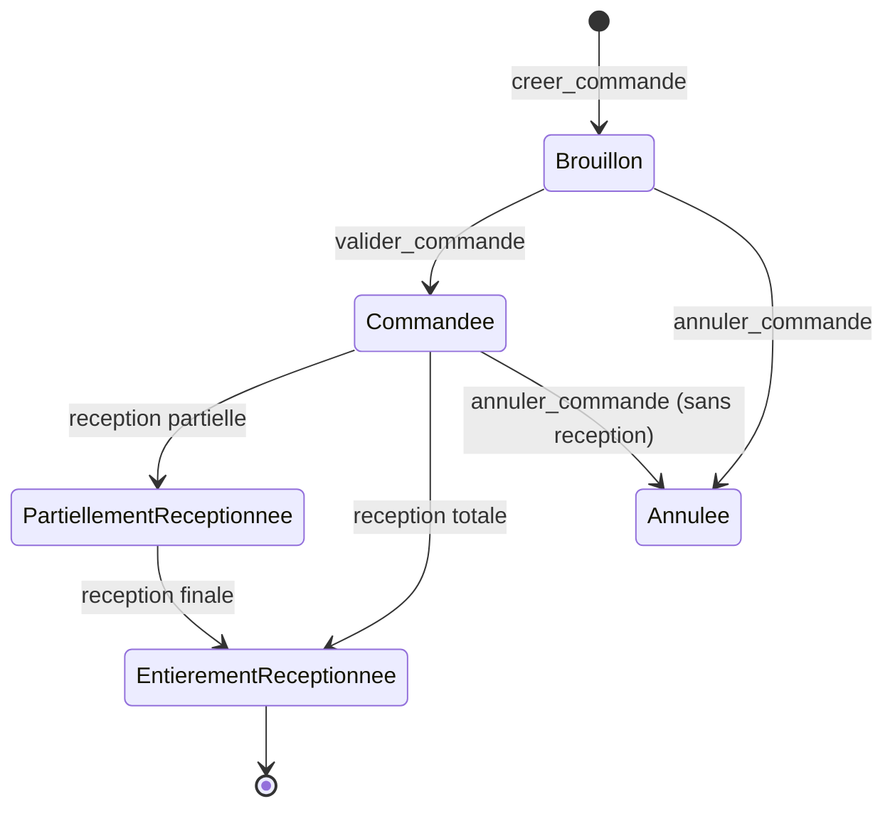
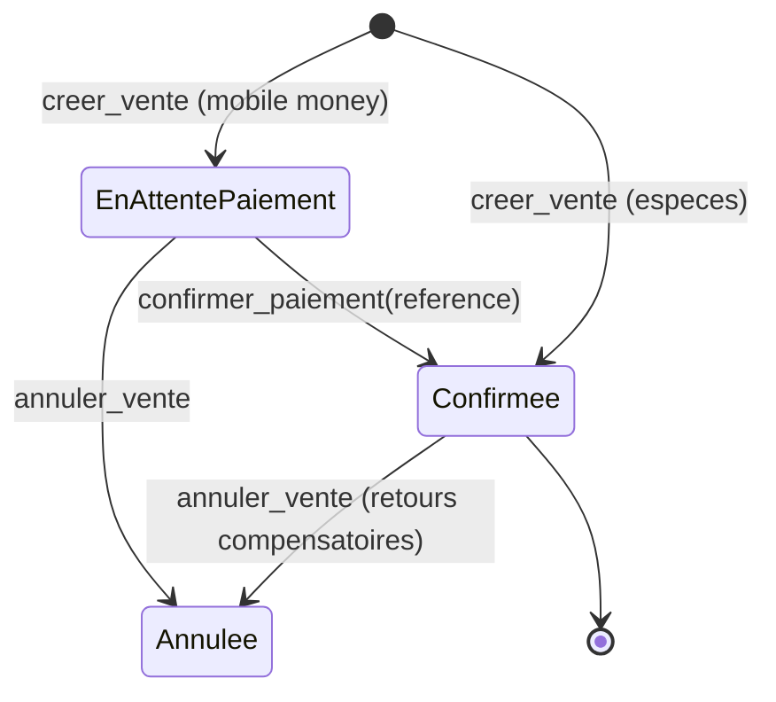
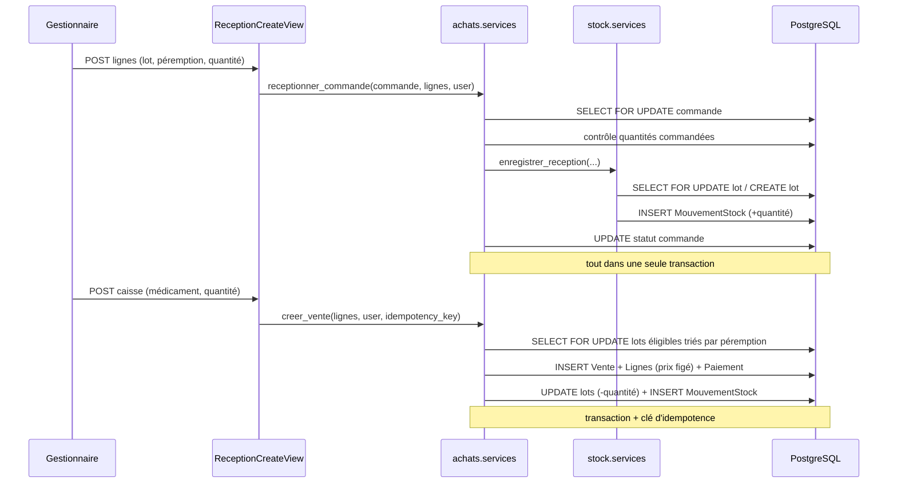

# Dossier de conception PharmaGest

## 1. Architecture MVT

PharmaGest suit l'architecture Modèle–Vue–Template de Django, complétée par une couche
**services** où résident toutes les opérations métier sensibles :

```
Template (Bootstrap 5)  ->  View (permissions, formulaires)  ->  Service (transaction)
                                        |                            |
                                     Form                        Model / PostgreSQL
```

Les vues ne modifient jamais directement le stock : elles appellent toujours un service
(`achats.services`, `stock.services`, `stock.allocation`, `ventes.services`).

## 2. Modèle conceptuel de données (MCD)



### Règles structurantes

- Un médicament possède un identifiant unique (RG01) et un code-barres unique s'il est renseigné (RG02).
- Une commande ne modifie pas le stock (RG04) ; une réception validée l'augmente une seule fois (RG05).
- Une vente validée diminue le stock une seule fois (RG06) ; le stock ne peut pas être négatif (RG07).
- Les lots périmés ou bloqués sont exclus de la vente (RG08).
- Aucune opération validée n'est supprimée : on archive, désactive ou compense (RG10).
- Les lignes de vente figent le prix appliqué et le lot (RG12).

## 3. Modèle logique de données (MLD)

| Table | Colonnes principales | Contraintes |
|-------|----------------------|-------------|
| `core_journalaudit` | id, utilisateur_id, action, modele, objet_id, details, adresse_ip, date | index sur date et (modele, objet_id) |
| `utilisateurs_utilisateur` | id, username, role, telephone, first_name, last_name, email, is_active | `AUTH_USER_MODEL` |
| `medicaments_categorie` | id, nom, description, cree_le, modifie_le | nom unique |
| `medicaments_medicament` | id, nom, denomination_generique, categorie_id, forme, dosage, laboratoire, code_barres, photo, prix_achat, prix_vente, seuil_alerte, statut, cree_par_id | code-barres unique conditionnel, prix >= 0 |
| `fournisseurs_fournisseur` | id, nom, adresse, telephone, email, identifiant_fiscal, contact_principal, actif | — |
| `clients_client` | id, nom, telephone, email, adresse, actif | données minimales |
| `achats_commandeachat` | id, numero, fournisseur_id, date_commande, statut, note, cree_par_id | numero unique |
| `achats_ligneachat` | id, commande_id, medicament_id, quantite, prix_unitaire | quantite > 0 |
| `achats_receptionachat` | id, numero, commande_id, date_reception, note, cree_par_id | numero unique |
| `achats_lignereception` | id, reception_id, ligne_achat_id, medicament_id, numero_lot, date_peremption, quantite, prix_unitaire | quantite > 0 |
| `stock_lotstock` | id, medicament_id, numero_lot, date_peremption, quantite, quantite_initiale, prix_achat, fournisseur_id, est_bloque, motif_blocage, ligne_reception_id, reference | quantite >= 0 |
| `stock_mouvementstock` | id, medicament_id, lot_id, type, quantite, motif, reference, utilisateur_id, date | quantite signée |
| `ventes_vente` | id, numero, idempotency_key, client_id, utilisateur_id, date, statut, mode_paiement, total, note | numero unique, clé d'idempotence unique |
| `ventes_lignevente` | id, vente_id, medicament_id, lot_id, numero_lot, date_peremption, quantite, prix_unitaire | prix figé (RG12) |
| `ventes_paiement` | id, vente_id, mode, montant, statut, reference, confirme_par_id, confirme_le | — |
| `ventes_retourvente` | id, vente_id, ligne_id, medicament_id, lot_id, quantite, motif, montant_rembourse, remis_en_stock, utilisateur_id, date | quantite > 0 |

## 4. Diagrammes d'états

### Commande d'achat



### Vente et paiement



## 5. Séquence critique : réception puis vente FEFO



## 6. Matrice des rôles (RG11)

```
                Admin  Pharmacien  Gestionnaire  Caissier  Responsable
Catalogue        X         X            X           X           X
Créer médicament X         X            X
Achats           X         X            X
Réception        X         X            X
Stock/incorrect. X         X            X
Caisse/vente     X                                  X
Paiements        X         X                        X
Retours          X         X                        X
Annuler vente    X         X
Rapports         X         X            X                       X
Audit            X         X                                    X
Utilisateurs     X
```

Les groupes Django sont créés par `python manage.py setup_roles`. La source de vérité est
`core/permissions.py` (`ROLE_PERMISSIONS`). Un compte peut cumuler plusieurs groupes ; le champ
`role` sert d'étiquette principale et est synchronisé avec les groupes à la création.

## 7. Choix de conception complémentaires

- **Sélection FEFO automatique** : le caissier ne choisit pas le lot, le système choisit le lot
  non périmé, non bloqué et dont la péremption est la plus proche. Cela évite les erreurs de
  délivrance et garantit RG08.
- **Paiement mobile money** : la vente est créée `en_attente_paiement` et le paiement
  `en_attente`. Seule la confirmation explicite avec référence transforme la vente en
  `confirmee` et le paiement en encaissement.
- **Correction d'inventaire** : `corriger_quantite` écrit un mouvement signé ; l'outil
  `verifier_stock` compare la quantité stockée à la somme des mouvements.
- **Idempotence** : une `UUIDField` unique sur `Vente` garantit qu'un double POST (ou double
  clic) ne crée qu'une seule vente.
